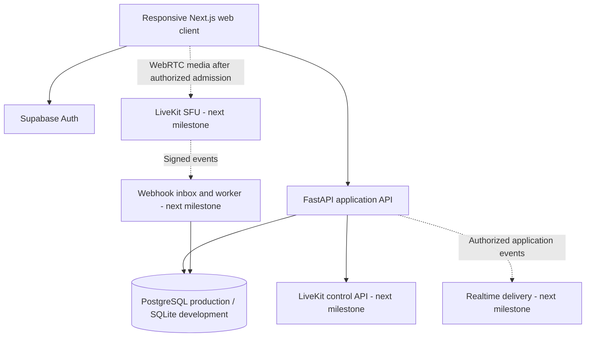

# ClassGuard AI architecture

Updated 6 November 2026. The supplied PRD v1.0 defines the product. This document records implementation choices and integration boundaries through the onboarding build.

## System boundaries

The frontend handles presentation and browser permissions. FastAPI owns authorization, class membership, attendance calculations and business rules. The media provider transports audio, video and screen streams. The database is the source of authority for membership and teaching assignments.

## Decisions implemented in the foundation

| Decision | Rationale and consequence |
| --- | --- |
| Next.js, React and TypeScript | Follow the PRD's browser-first direction. One responsive client serves desktop, tablet and phone layouts. |
| Plain CSS for the initial app shell | Keep the first build small and inspectable. Tailwind/shadcn can be introduced when reusable UI requirements justify them. This is a documented implementation choice beneath the PRD's proposed UI stack. |
| FastAPI and SQLAlchemy | Typed request validation and explicit repository queries. Database models can target SQLite for local setup and PostgreSQL for deployment. |
| Supabase Auth with JWT and current-user verification | Verify issuer, signature, audience and expiry, then fetch the current account and require confirmed email. Read institution permissions from database membership, rather than editable client metadata. |
| SQLite for local development | A developer can start the API without provisioning a database. Production and tenant-isolation validation must run against PostgreSQL before a pilot. |
| Explicitly labeled local UI preview | Allows design review before credentials exist. Preview state is separate from authenticated API data and grants no server authority. |
| Media integration follows admission | Implement classroom entry rules before generating a LiveKit credential. An unprotected demo token endpoint would undermine the central product requirement. |

## Authorization model

Every request to an institution route must verify the authenticated user's active membership in that institution. Resource IDs and institution IDs are untrusted routing inputs. Teachers see classes they own in the initial milestone. Students see classes through enrollment. Institution administrators manage their own institution. HOD, parent and platform support roles are subsequent milestones.

Tenant scope must eventually apply to downloads, object storage keys, exports, WebSocket subscriptions, caches, jobs and media credentials as well as database queries. A UI role selector is never an authorization mechanism. Development test overrides must remain inside tests.

The security update adds bounded API input and per-process peer/account rate limits before expensive work. These require shared enforcement at the deployment edge before public use. Every protected request performs a fresh provider account lookup; provider failure denies access, trading some availability for current identity checks. The frontend sends anti-framing, MIME and referrer headers. Its CSP does not yet constrain script sources. See `SECURITY_REVIEW.md` for tested attacks, scope and residual risks.

## Institution onboarding and enrollment

An authenticated account can create a new institution and becomes its first administrator. This grants no access to another institution. Administrators create teacher/student invitations and manage non-administrator memberships. Administrator promotion, ownership transfer and administrator removal remain trusted-operator actions rather than public API operations.

Invitations bind an institution, normalized email address, role and expiry to a cryptographically random secret. The database stores only its SHA-256 hash. The create response exposes the secret once; the browser constructs a fragment-based link for manual sharing. Acceptance requires a matching authenticated email, an active institution and an unused, unrevoked, unexpired invitation. Conditional consumption and membership creation occur in one transaction. An invitation cannot silently reactivate or change an existing membership. Accounts must be created through Supabase; no service-role key is exposed to the browser and no invitation email is sent by this API.

The directory stores known account email addresses separately from the original membership schema. Locally provisioned users can appear by ID until their authenticated identity becomes known. These additions use new tables, so the local `init-db` command can create them while preserving existing institution, membership, class and enrollment records. This is an additive development upgrade, not a replacement for versioned production migrations.

An administrator can manage class enrollment throughout the institution. A teacher can manage only their own classes and sees active students in the directory. Students cannot browse the institution directory or manage enrollment. Enrollment requires an active student membership in the same institution. The browser keeps invitation acceptance separate from class admission; joining an institution does not automatically enroll a student or authorize a media connection.

Changing a teacher/student role removes that person's old student enrollments. Deactivating a membership blocks access while retaining its enrollments, so an administrator can explicitly restore the same access by reactivating it. Reissuing an invitation to the same email revokes previous outstanding invitations for that institution. Directory information is descriptive; it never supplies authorization.

## Admission and media design for the next milestone

1. Authenticate the user and resolve an active institution membership.
2. Check classroom enrollment or teaching assignment and the live session's lifecycle.
3. Create an idempotent admission request. Waiting students receive no classroom media token.
4. A teacher approves an eligible request, or the configured policy admits it automatically.
5. Recheck removal, lock, membership and session state when issuing a short-lived room-specific credential.
6. Use opaque identities and room IDs. Keep LiveKit API secrets on the server.
7. Apply publishing restrictions at the media server. Removal must terminate the connection and prevent re-entry.

LiveKit token expiry primarily controls initial connection. Reconnection and revocation behavior depends on the deployment, so cached-token re-entry must be tested with the selected Cloud or self-hosted configuration. [LiveKit tokens and grants](https://docs.livekit.io/frontends/reference/tokens-grants/)

## Durable event processing

The future webhook endpoint will verify the raw request signature, assign a unique provider/event constraint, store the original event and acknowledge after durable receipt. A worker applies state transitions and recomputes derived records. Preserve event time and receipt time. Retries and reordered events must converge on the same result.

Client heartbeats and visibility events provide context. They do not establish authoritative connected attendance. Browser background throttling and lifecycle suspension require reconciliation and uncertainty states. [Page Visibility API](https://developer.mozilla.org/en-US/docs/Web/API/Page_Visibility_API)

## Data and deployment

Production uses PostgreSQL with migrations, backups and least-privilege database credentials. Tenant access checks exist in the API and require negative integration tests. PostgreSQL RLS may provide defense in depth after its connection/claim propagation model has been explicitly designed and tested. The foundation does not claim that API query filters implement database RLS.

Next.js and FastAPI are separate deployable applications. A Node-capable frontend host and a container/API host are needed. A media service and HTTPS are required for real calls. No production cloud deployment is configured by this foundation.

## AI boundary

Summaries and revision questions will use approved transcript content, run as background work and require teacher review. Provider selection, retention and costs remain deployment decisions. Computer vision is a later evaluation gate. Emotion inference, covert app monitoring and automated disciplinary conclusions are outside the product scope.
